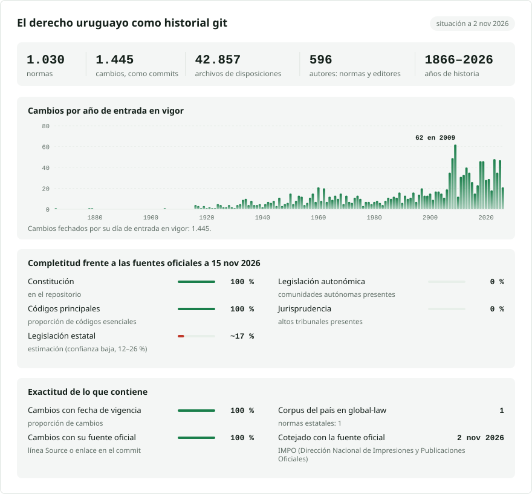

# Uruguay: historia del derecho en git

**Español** · [English](README.en.md)

<picture>
<source media="(prefers-color-scheme: dark)" srcset="data/es/effort-dark.svg">

</picture>

El derecho nacional del Uruguay como historial de git: un archivo por artículo, un commit por ley (o plebiscito), fechado el día en que entró en vigencia, y la ley que hizo cada cambio como autora del commit. `git blame` nombra la ley de cada párrafo; `git log` enumera cada cambio de un artículo; al elegir una fecha se obtiene el texto vigente ese día.

Forma parte de [lexifina/global-law](https://github.com/lexifina/global-law), un único historial de git para el derecho de todos los países: este es el derecho nacional del Uruguay, que global-law lee en `uruguay/national/acts/`.

**Qué contiene ahora:** la Constitución de 1967 con sus cuatro reformas plebiscitadas, 13 códigos (entre ellos el Código Civil, el Código Penal y el Código General del Proceso) y 255 leyes y decretos-ley, cada uno desde su primera versión o su entrada en vigencia hasta hoy; y otras 761 leyes solo con su texto vigente, y otras 260 leyes y decretos-ley leídos de IMPO el 27 de noviembre de 2026, con una versión cada uno (tal como se publicaron, o el texto actualizado de IMPO). Son 1.290 normas con 2.257 versiones vigentes de 1866 a 2026; otras 10 versiones, que entrarán en vigencia el 1° de enero de 2027 (Ley 20.531), están en la rama `futuro`. [`data/versions.json`](data/versions.json) enumera cada norma con el día en que entró en vigencia cada versión; [`data/laws.csv`](data/laws.csv) enumera las 1.278 normas que nombra el registro, con sus fechas.

Cada norma es una carpeta por tipo, año y número, con un archivo por artículo: `leyes/2008/18331-de-proteccion-de-datos-personales/` es la Ley Nº 18.331 de Protección de Datos Personales, `decretos-ley/1974/14219-ley-de-arrendamientos-urbanos-y-suburbanos/` un decreto-ley, `codigos/codigo-civil/art-1700.md` el art. 1700 del Código Civil y `constitucion/art-067.md` el art. 67 de la Constitución. [`data/paths.json`](data/paths.json) relaciona el id de cada norma con su carpeta, y el `README.md` de cada carpeta enumera sus disposiciones y cuándo cambió cada una.

El texto está en español, tal como lo publica IMPO (y el Parlamento, para los textos anteriores de la Constitución).

## Preguntas como comandos de git

| Pregunta | Comando |
| --- | --- |
| Cada cambio del art. 67 de la Constitución | `git log -p --follow --word-diff -- constitucion/art-067.md` |
| ¿Qué reforma escribió cada párrafo del art. 67? | `git blame constitucion/art-067.md` |
| Cada versión de la Constitución, con el día en que entró en vigencia cada una | `git log --author=impo.invalid --format="%h %(trailers:key=In-force,valueonly,separator=) %an" -- constitucion constitution/constitucion` |
| El art. 67 vigente el 1° de enero de 1990 | `python tools/on.py 1990-01-01 constitucion 67` |

Las normas pasaron a estas carpetas el 10 de noviembre de 2026: `git log` necesita `--follow` para un archivo, o el nombre anterior de la carpeta junto al nuevo; `git blame` y `tools/on.py` siguen el traslado.

**Fuera de git**, también alojamos este registro de forma pública y gratuita:

- **[Pregunte a Claude sobre el derecho uruguayo](https://global-law.lexifina.com/v1/try_claude?country=uruguay)**: abre Claude con una primera pregunta ya preparada.
- **[Pregunte a ChatGPT](https://global-law.lexifina.com/v1/try_chatgpt?country=uruguay)**: la misma pregunta en ChatGPT.
- **[Busque en el derecho uruguayo en nuestro sitio](https://lexifina.com/law?country=uruguay&q=licencia+anual)**: una búsqueda de "licencia anual", con el texto de cada disposición y sus versiones, sin necesidad de cuenta.
- **[API REST para desarrolladores](https://global-law.lexifina.com/v1/search_law?query=licencia+anual&jurisdiction=uruguay)**: la misma búsqueda en JSON, sin clave. Consulte la [documentación aquí](https://lexifina.com/api/global-law).

Ambos asistentes leen el registro mediante el conector gratuito Global law (MCP, `https://global-law.lexifina.com/mcp`); la primera vez, el chat le da el enlace para añadirlo. Pregunte en español o en inglés.

**Alójelo usted mismo fácilmente.** Solo hacen falta git y Python, y las herramientas se ejecutan en su propio equipo:

```sh
git clone --depth 1 https://github.com/lexifina/global-law && cd global-law
python3 tools/countries.py add uruguay/national/acts
python3 tools/law.py show 2026-01-01 uruguay/national/acts/constitucion/art-067.md
```

Abierto en Claude Code, Cursor, VS Code o Codex, el clon también inicia un servidor MCP local con las mismas herramientas ([MCP.md](https://github.com/lexifina/global-law/blob/main/MCP.md)).

## Fechas

Cada commit está fechado al mediodía, hora de America/Montevideo, del día en que el cambio entró en vigencia, y lo lleva en su trailer `In-force:`:

- decide la cláusula de vigencia de la propia ley; si no la tiene, el art. 1 del Código Civil la hace obligatoria diez días después de su publicación. Ningún cambio se fecha antes de que su ley fuera promulgada y publicada: cuando una ley indica un día anterior, se fecha diez días después de la publicación (la Ley 18.719, publicada el 5 de enero de 2011, "regirá a partir del 1° de enero de 2011": 15 de enero de 2011);
- la Constitución entró en vigencia el 15 de febrero de 1967 y la reforma de 1989 el 1° de mayo de 1990, como dicen sus disposiciones transitorias; las reformas de 1994, 1996 y 2004 entraron en vigencia cuando la Corte Electoral proclamó el resultado, que ninguna fuente fecha, por lo que se fechan el día del plebiscito;
- una ley con solo su texto vigente se fecha por el día en que entró en vigencia la última ley que nombran las notas de IMPO (458 leyes), o por la última fecha de modificación que da IMPO o por su promulgación (303 leyes), pendiente todavía de corregir al día en que entró en vigencia;
- git no puede almacenar fechas anteriores a 1970, por lo que los 365 commits anteriores llevan fechas a partir del 1970-01-01, con el día real en `In-force:`. Para consultar una fecha use `tools/on.py`, no `git log --before`.

Cada cambio se atribuye a la ley, el decreto-ley o el plebiscito que lo hizo, con una dirección que no puede existir (`ley-18719@impo.invalid`, `plebiscito-1996-12-08@impo.invalid`), y solo en la medida en que lo nombran las notas de IMPO sobre ese artículo. Una primera versión que no es el texto tal como se sancionó, como el texto vigente de las 761 leyes, se atribuye al editor, IMPO, como la "oldest version available" (la versión más antigua disponible); el committer es Lexifina.

## Cómo se comprueba

- Cada versión de la Constitución tiene las palabras de la edición del Parlamento de ese año, salvo unas 40 unidades en las que las transcripciones de IMPO y del Parlamento difieren ("aun"/"aún"), y las unidades que cambió cada reforma son exactamente las que las notas de IMPO atribuyen a ese plebiscito (2, 1, 34 y 3); [`data/verification.json`](data/verification.json) enumera ambas cosas.
- El texto actual de cada norma es el texto actualizado de IMPO, unidad por unidad; un texto anterior se toma solo de una fuente (el texto original de una ley en IMPO, o la redacción que cita una ley modificativa). Cada excepción está en [`REPRODUCE.md`](REPRODUCE.md).
- `tools/check_repo.py` vuelve a leer desde git cada versión el día en que entró en vigencia y el día anterior; ambas deben coincidir con el corpus, cuyo sha256 está en `data/corpus.sha256`. `REPRODUCE.md` deja constancia de que todavía no se ha comparado una segunda construcción.
- El historial solo crece por adición (`tools/append.py`): no hay commits de fusión (merge) en `main`, ni fechas de commit que retrocedan, ni nada con fecha futura, y los trailers de todos los commits se pueden analizar.
- [vulnerabilities/](vulnerabilities/): posibles errores de redacción en este derecho, hallados por los detectores de global-law y revisados a mano. Aún no se ha ejecutado.

## Lo que no muestra

- **La mayor parte del derecho nacional.** Son 1.290 leyes, códigos y decretos-ley; los decretos del Poder Ejecutivo, la normativa departamental y la jurisprudencia no están aquí.
- **Las versiones anteriores de las 761 leyes con solo su texto vigente**, que tienen una versión cada una.
- **Los cambios anteriores a la primera versión de una norma o que no figuran en las notas de IMPO**: el Código Civil antes de su reedición de 1994 (Ley 16.603), las constituciones anteriores a 1967 y el Código Penal entre 1934 y 1969, donde IMPO no nombra ninguna ley modificativa.
- **Los textos que ninguna fuente da.** Cuando ninguna fuente da el texto entre dos leyes modificativas, el cambio aparece el siguiente día cuyo texto se conoce; se dejan fuera unos pocos elementos cuyo inicio no se puede situar, cada uno enumerado en `REPRODUCE.md`.
- **Los encabezados y las normas a las que IMPO solo remite**: no se conservan los encabezados de libros, títulos y capítulos, y la Ley de Urgente Consideración (Ley 19.889) no es una norma propia; sus cambios están en las leyes que modificó.

## Fuentes

| Fuente | Tipo | Versiones anteriores | Notas |
| --- | --- | --- | --- |
| [IMPO, Base de datos de normativa](https://www.impo.com.uy/bases) (Dirección Nacional de Impresiones y Publicaciones Oficiales) | Base de datos oficial de la legislación nacional | no: el texto actualizado de hoy, y el texto original de cada artículo modificado | Sus notas nombran la ley de cada cambio ("redacción dada por", "agregado/s por") |
| [Parlamento del Uruguay, Constitución](https://parlamento.gub.uy/documentosyleyes/constitucion) | La Constitución | sí, las ediciones de 1967, 1989, 1994, 1997 y 2004 | Leídas mediante capturas de sus páginas en el Internet Archive |

## Licencia

Véase [`LICENSE`](LICENSE). Los textos jurídicos son los textos oficiales publicados por IMPO y el Parlamento del Uruguay, sobre los que Lexifina no reclama ningún derecho; los textos y datos de IMPO se usan bajo la [Licencia de Datos Abiertos – Uruguay, versión 0.1](https://www.impo.com.uy/wp_impo/wp-content/uploads/2018/06/licencia-de-datos-abiertos.pdf), y se modificaron: se reunieron en un historial de versiones fechadas, con el formato normalizado. El historial, los mensajes de commit, las tablas y las herramientas son CC0 1.0.

Ningún modelo de IA escribió, tradujo ni corrigió texto jurídico, y ninguno se ejecuta al construir el historial. Claude Code con Claude Opus 5.5 escribió los scripts y leyó los artículos de vigencia de las leyes en los que se basan las fechas enumeradas en [`REPRODUCE.md`](REPRODUCE.md).

Esta es una traducción de la versión inglesa ([README.en.md](README.en.md)); si difieren, prevalece la versión inglesa.

## Visualizaciones

- [visualisations/](visualisations/): gráficos hechos a partir de este repositorio. Aún no se han hecho.

## Más información

Del repositorio [lexifina/global-law](https://github.com/lexifina/global-law) (páginas en inglés):

- [FEATURES.md](https://github.com/lexifina/global-law/blob/main/FEATURES.md): todas las funciones y lo que cada corpus debe admitir (`git blame`, `law.py`, herramientas MCP)
- [FAQ.md](https://github.com/lexifina/global-law/blob/main/FAQ.md): preguntas y respuestas · [CONTRIBUTING.md](https://github.com/lexifina/global-law/blob/main/CONTRIBUTING.md): proponer cambios · [MCP.md](https://github.com/lexifina/global-law/blob/main/MCP.md): servidor MCP · [REPRODUCE.md](https://github.com/lexifina/global-law/blob/main/REPRODUCE.md): cómo se ha construido · [CHANGELOG.md](https://github.com/lexifina/global-law/blob/main/CHANGELOG.md)
- [FRESHNESS.md](https://github.com/lexifina/global-law/blob/main/FRESHNESS.md): lo actualizado que está cada corpus · [Supervisión](https://github.com/lexifina/global-law/tree/main/monitoring): si las actualizaciones funcionan · [WATCHING.md](https://github.com/lexifina/global-law/blob/main/WATCHING.md): cómo se vigila cada fuente oficial para detectar cambios
- [performance/](https://github.com/lexifina/global-law/tree/main/performance): la rapidez de las herramientas, medida
- [visualisations/](https://github.com/lexifina/global-law/tree/main/visualisations): gráficos y conexiones a través del derecho de todo el mundo
- [Vulnerabilidades](https://github.com/lexifina/global-law/tree/main/vulnerabilities): errores en las normas tal como se publicaron
